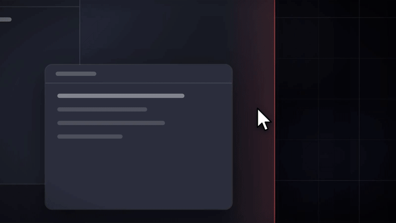

<div align="center">

# OneScreen

**Push your cursor toward a monitor. OneScreen moves it there.**

[](https://github.com/mxnyawi/OneScreen/actions/workflows/ci.yml)
[](LICENSE)




</div>

**Made for hot desks and changing setups.** If you work at a different desk most days, or split
your week between home and the office, the monitor is rarely on the side your computer expects.
The mouse hits an invisible wall at the edge of the screen, and the fix is a trip into display
settings to drag rectangles around. Every desk, every day.

With OneScreen you just keep pushing the mouse toward the monitor. The layout flips to match the
desk you're at, the cursor carries on across, and the edge glows to show where it came through.

- **Remembers every desk.** Plug in at home, at the office or at the same hot desk again, and that
  desk's layout comes back on its own.
- **No setup.** No sensors, no camera, nothing to configure. It reacts to something you already do.
- **Stays out of the way.** It lives in the menu bar or tray, ignores corners, drags and games,
  and never sends anything over the network.

> **Status: early preview (v0.1).** It builds and passes its tests on macOS and Windows in CI, but it
> hasn't been run on many real desks yet. If something misbehaves,
> [please open an issue](https://github.com/mxnyawi/OneScreen/issues/new/choose).

---

## Install

Paste one line into a terminal. It downloads OneScreen, starts it, and sets it to start at
login. Run the same line again later to update.

**macOS** (13 or later, Apple Silicon or Intel), in Terminal:

```bash
curl -fsSL https://raw.githubusercontent.com/mxnyawi/OneScreen/main/install.sh | bash
```

**Windows** (10 or 11), in PowerShell:

```powershell
irm https://raw.githubusercontent.com/mxnyawi/OneScreen/main/install.ps1 | iex
```

That's it. Look for the two-screens icon in the menu bar (macOS) or system tray (Windows), then
push your cursor toward your monitor.

No admin rights are needed. The installers only touch the app itself, a Start menu shortcut
(Windows), and a launch-at-login entry. Read them first if you like:
[install.sh](install.sh), [install.ps1](install.ps1).

<details>
<summary>Uninstall</summary>

**macOS:**
```bash
curl -fsSL https://raw.githubusercontent.com/mxnyawi/OneScreen/main/install.sh | bash -s -- --uninstall
```

**Windows:**
```powershell
irm https://raw.githubusercontent.com/mxnyawi/OneScreen/main/uninstall.ps1 | iex
```

Your settings file stays behind (see [Where your settings live](#where-your-settings-live)).
Delete it too if you want a clean slate.

</details>

<details>
<summary>Build from source instead</summary>

Install [Rust](https://rustup.rs), then:

```bash
git clone https://github.com/mxnyawi/OneScreen.git
cd OneScreen
cargo run --release -p onescreen
```

On macOS you also need the Xcode Command Line Tools (`xcode-select --install`). On Windows you need
the [Visual Studio Build Tools](https://visualstudio.microsoft.com/visual-cpp-build-tools/) with
"Desktop development with C++". More in [CONTRIBUTING.md](CONTRIBUTING.md).

</details>

---

## Use it

1. Move the cursor toward your monitor.
2. If it stops at the edge, **keep pushing** for about half a second.
3. The monitor moves to that side, the cursor continues onto it at the same height, and the edge
   glows.

The new layout is saved for this desk (this exact set of displays). Next time you connect the same
displays, OneScreen restores the layout about a second after they settle.

### Menu

Click the icon in the menu bar (macOS) or tray (Windows):

| Item | What it does |
| --- | --- |
| **Enabled** | Turns OneScreen on or off. |
| **Sensitivity** | How hard you have to push: Low ≈ 700 pt, **Medium ≈ 400 pt** (default), High ≈ 250 pt, within 1.2 s. Try High on a trackpad. |
| **Remember layout per desk** | Restore each desk's layout when you plug its displays in again. |
| **Edge glow** | The flash on the edge the cursor enters through. It's also skipped when your system's reduce-motion setting is on. |
| **Pause during full-screen apps** | Windows only: ignore pushes while a game or presentation is full screen. |
| **Undo last flip** | Put the displays back where they were. |
| **Forget learned desks** | Clear every remembered layout. |
| **Launch at login** | Start OneScreen when you log in. |
| **About OneScreen** | Opens this page. |

### What doesn't trigger a flip

To stay out of your way, OneScreen ignores:

- the **corners** (Hot Corners, the Start button, close buttons),
- edges that **already lead to a display**,
- **sliding along** an edge on the way to a corner,
- anything while a **mouse button is held** (dragging, selecting),
- **mirrored** displays or a single display,
- a second flip within **2 seconds** of the last one.

---

## How it works

When the layout is wrong, the cursor stops at an edge but your hand keeps moving the mouse.
OneScreen reads that raw movement, which keeps arriving even when the cursor can't move, and adds up
the outward push. Once it passes the threshold, OneScreen:

1. Moves the other display to the side you pushed toward, centred along that edge. If that display is
   the main one (both systems pin it at 0,0), it moves your current display to the far side
   instead. With three or more displays it moves the one furthest from where you pushed.
2. Applies the change through the system's own display settings API, so it sticks exactly like
   a change made in Settings.
3. Moves the cursor to the matching point just inside the monitor's edge, and glows that edge.

| | macOS | Windows |
| --- | --- | --- |
| Mouse movement | `NSEvent` global monitor (`deltaX`/`deltaY`) | Raw Input (`WM_INPUT`, background sink) |
| Displays | CoreGraphics (`CGGetActiveDisplayList`, `CGConfigureDisplayOrigin`) | `QueryDisplayConfig` / `SetDisplayConfig` |
| Display identity | EDID vendor / model / serial | EDID manufacturer / product / serial (falls back to the connector if a monitor reports none) |
| Glow | Borderless click-through `NSWindow` | Layered click-through window |
| Launch at login | LaunchAgent in `~/Library/LaunchAgents` | `HKCU\…\CurrentVersion\Run` |

### Privacy

OneScreen reads **mouse movement only**: no keystrokes, no screen contents, no camera. It makes **no
network requests** and has no analytics. Windows asks for no permissions. macOS normally doesn't
either. If it ever asks for **Input Monitoring** or **Accessibility**, that's what allows OneScreen to
see mouse movement while other apps are in front.

### Where your settings live

| macOS | Windows |
| --- | --- |
| `~/Library/Application Support/OneScreen/state.json` | `%APPDATA%\OneScreen\state.json` |

It's plain JSON with your settings and learned desks. Delete it to start fresh.

---

## Troubleshooting

<details>
<summary><b>Nothing happens when I push</b></summary>

- Check that **Enabled** is ticked in the menu.
- Push straight toward the monitor, away from the corners. Pushes within 40 points of a corner
  are ignored on purpose.
- On a trackpad, set **Sensitivity → High**.
- Make sure no mouse button is held down.
- If the displays are mirrored, there's nothing to arrange.

</details>

<details>
<summary><b>It flips when I don't want it to</b></summary>

Set **Sensitivity → Low**, and [open an issue](https://github.com/mxnyawi/OneScreen/issues/new/choose)
describing what you were doing. False triggers are treated as bugs.

</details>

<details>
<summary><b>The screens go black for a second (Windows)</b></summary>

Some GPUs and docks blank the screens briefly whenever the layout changes. That includes changes made
in Settings. OneScreen waits for the change to finish before moving the cursor.

</details>

<details>
<summary><b>Wrong layout restored at a desk</b></summary>

Rearrange it the way you want, in Settings or with a push. OneScreen remembers the last layout you
used at each desk. **Forget learned desks** clears them all.

</details>

---

## Project layout

```
crates/onescreen-core   Platform-free logic: gesture detection, arranging, per-desk memory (fully tested)
crates/onescreen        The menu bar / tray app and the macOS and Windows layers
scripts/                Packaging (macOS .app bundle)
demo/                   The launch film, made in code with Remotion (see demo/README.md)
```

Run the tests with `cargo test --workspace`. They run anywhere, including Linux. See
[CONTRIBUTING.md](CONTRIBUTING.md) for the development setup, the architecture, and the
real-hardware test checklist.

## Roadmap

- Signed and notarised macOS builds, a Homebrew cask, a signed Windows installer, and WinGet
- A first-run window with a short animation of the gesture
- Cycling between displays with repeated pushes on 3+ display setups
- Naming desks and forgetting them one at a time
- An optional keyboard shortcut for trackpad users
- Linux (X11 / Wayland)

Ideas and votes are welcome in [issues](https://github.com/mxnyawi/OneScreen/issues).

## Contributing

Bug reports, especially "it did the wrong thing on my desk", are the most useful thing right now.
See [CONTRIBUTING.md](CONTRIBUTING.md). Please follow the [Code of Conduct](CODE_OF_CONDUCT.md), and
report security issues privately as described in [SECURITY.md](SECURITY.md).

## License

[MIT](LICENSE) © OneScreen contributors
